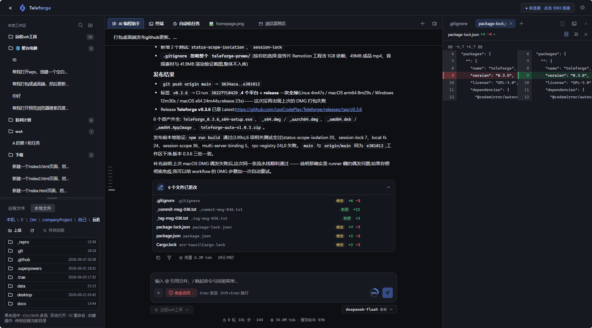

# Teleforge — 支持 SSH 远程与本地互通的 AI 编程工具

**语言 / Languages：[简体中文](README.md) · [English](README.en.md)**

一个本地运行的 Web 工具：通过 SSH 连接远程服务器并**保持连接**，让 **AI Agent 在远程服务器上真实地读写文件、执行命令、搜索代码**；未连接时则在本机工作区上执行同样的操作。远程与本地一套界面、一套工具，像把 AI 编程助手直接装进目标环境一样。


---

## 界面预览

<p align="center">
  
</p>

---

## 核心能力

**连接与访问**

- **SSH 连接保持**：10s 心跳保活，断线后按指数退避**自动重连**，实时状态展示；支持密码认证与私钥认证（含口令）。
- **连接配置保存**：把主机/端口/用户/认证方式/密码或密钥保存为命名配置（存于服务端 `server/data/ssh-profiles.json`，密码/私钥只留服务端、不下发前端），下拉即可在**多台服务器**间快速切换。
- **多服务器并行**：切换服务器**不会中断**正在回答的会话——它绑定原服务器继续在后台运行（工具操作仍作用于原服务器），会话列表里保留该「运行中」条目，切回后已生成的内容一条不少。
- **多浏览器同时在线**：支持多个浏览器窗口/标签同时连接——状态与 Agent 事件广播给全部在线端；所有端都断开期间产生的 Agent 事件会被**按序缓存**，任一端重连后自动补发，不会出现「后台已完成但界面还卡在生成中」。

**远程 ↔ 本地双工作区**

- **远程工作区**：连接后浏览远程文件系统，选任意目录作为工作区；Agent 的写/改/删以工作区为界，且**严禁删除工作区根目录**。
- **本地工作区**：未连接时进入本地模式，Agent 可在本机目录上执行**同样的操作**（读写/搜索/命令），远程与本地共用同一套界面与工具。本机侧的工具是与远程**一一对应**的镜像：`list_local_dir` / `read_local_file` / `write_local_file` / `edit_local_file` / `create_local_dir` / `delete_local_path` / `search_local_code` / `run_local_command` / `get_local_info` / `glob_local` / `grep_local`。
- **「不在工作区对话」全盘模式**：会话也可以**不绑任何工作区**——此时 AI 的文件边界放宽到**整台服务器**（本地模式下是**整台电脑**），而不是只能在一个目录里读写。代价是**必须给绝对路径**（没有基准的相对路径没有意义），删除保护的对象也随之下移：本地删东西时拒删的是**磁盘 / 文件系统根**，而不是工作区根。这类会话在会话面板里单独成组（「未指定工作区」），`get_workspace_info` 返回的 `scope` 会写清当前边界是某个工作区还是「整台服务器 / 整台电脑」。
- **导航式文件管理**：按目录逐层浏览、双击打开；**多选**（Ctrl/Shift 点选、Ctrl+A 全选、Delete 删除），右键菜单对选区执行**删除/下载/复制/粘贴**；编辑保存由服务端做越权校验。
- **代码编辑器**：点击文本文件直接以 **CodeMirror 6 编辑器**打开——语法高亮（JS/TS/Python/Go/Rust/Java/C/C++/PHP/SQL/HTML/CSS/Markdown/YAML/XML/Shell 等）、行号/代码折叠/括号匹配/自动补全/搜索、撤销重做、右键菜单（剪切/复制/粘贴/复制路径），**Ctrl+S 保存写回**（远程写回 SFTP，越权由服务端校验；本地直接写盘）；保留文件原有行尾风格（LF/CRLF 整文件统一）。
- **媒体在线预览**：图片/视频/音频/PDF 点击即看——服务端按扩展名流式返回字节流（支持 **Range 请求**，视频/音频可拖动进度条），也可从预览直接下载。
- **文件查看器**：文本文件改动实时标脏，「保存修改」一键写回；二进制文件识别提示。

**AI Agent 编程**

- 对话式下达指令，Agent 通过工具在目标环境（远程或本地）**真实操作**：
  - `list_directory` 列目录 · `read_file` 读文件（分片读取、二进制识别）
  - `write_file` 写文件 · `edit_file` 精确文本替换
  - `run_command` 执行命令（**流式输出**、超时、输出截断：前 60k + 后 40k）
  - `create_directory` / `delete_path`（仅限工作区）· `get_workspace_info` 环境感知 · `search_code` 代码搜索（rg/grep）
  - `glob` / `grep` **文件发现**：按文件名/路径模式找文件、按内容正则找代码，**远程与本机两套实现**（本机镜像 `glob_local` / `grep_local` 与之一一成对）。本机实现由**打包在依赖里的 ripgrep 二进制**（`@vscode/ripgrep`）驱动，不经 shell、argv 固定，路径里有奇怪字符也不会被解释；注册表把 `Glob` / `Grep`（含大小写变体）这类别名统一解析到远程实现，未连 SSH 时自动回落到本机实现；远端缺 ripgrep 时会先尝试自动安装。
  - `web_search` **联网搜索**（免 API Key、不依赖任何 npm 包）：后端是 DuckDuckGo，按「**远端 ddgs** → **本机 python + ddgs** → **本机 Node 直抓**」三级优先级执行——连着 SSH 时在服务器上部署并调用 ddgs（缺失**自动 pip 安装**，优先 root / 免密 sudo；境外 VPS 通常比本机更可靠），未连接或远端失败时回落本机，最后兜底零依赖的 Node fetch。首次安装可能要等一会儿，所以工具超时给到 240 秒；返回带标题/摘要/链接的**引用来源**并标注本次实际走的路径（`remote` / `local`），前端以来源卡片呈现
  - `present` **交付成果物**：模型显式声明「这几个文件是给你用的最终产物」并各配一句人话说明——它与「N 个文件已更改」是两张卡（后者是宿主观察到的**事实**：本轮工作区里哪些文件被动过；前者是模型声明的**交付意图**：哪个是给你用的），合成一张恰好会丢掉用户唯一关心的那个信息。卡片只显示路径与说明、**不复制内容**，点击打开的就是那个路径上的**当前**文件，因此永远不会给你看过期副本
  - `browser_*` 操控浏览器（真机 Chrome/Edge 或内置预览；`browser_navigate` 导航当前正在操作的那个标签，不会越开越多）——见下方「浏览器预览 / 真机浏览器」
  - `computer_*` **AI 操控本机电脑**（仅 Windows：列窗口 / 启动应用 / UIA 元素级点击输入 / OCR 按文字定位 / 截图 / 鼠标键盘）——见下方「AI 操控本机电脑」
  - `schedule_*` **自动化任务**（定时 / 重复 / cron）——见下方「自动化任务」
  - `list_project_terminals` / `stop_project_terminal` 查看与停止 AI 后台拉起的「运行终端」
  - `subagent` 派发**只读调研子代理**：派发时由 AI 自己写清**任务目标 + 边界**（objective/scope，或一段完整提示词；写得太含糊会被工具直接打回并给出模板），子代理只按这份提示词干活；默认走**本工具内置 agent**（同一个模型、同一套远程/本机工作区与工具栈，in-process 执行，不调用外部 agent；外部 agent 未接入，显式指定会直接报错）。给它一个自包含的任务，它用**独立上下文**去查（看不到当前对话、中间步骤不回传），只把最终结论交回来——适合「几处并行探索」「把大范围搜索挡在本轮上下文之外」。子代理只能读（列目录 / 读文件 / 搜索代码 / 环境信息 / 网络搜索），写文件与执行命令仍由主代理完成。**默认后台派发、不阻塞主会话**（对齐 deepseek-harness 的 continuable subagent）：调用立刻返回 `started subagent <id>`，主代理继续干自己的活；子代理跑完一轮会把一条**结算通知**（结束情况 + 最后结论）送回本对话，主代理因此被唤醒继续处理——所以结果照样回得来，而不是让主会话干等。派发出去的子代理是**常驻**的：主代理可用 `send_message` 继续派活（给空闲的子代理发一条就唤醒它开新的一轮）、用 `interrupt_agent` **暂停**它当前这一轮（排队消息保留、下一条消息继续）、用 `list_agents` 看它们是 running 还是 inactive；你也能在子智能体会话里直接**打字发消息**、点「停止」暂停它当前这一轮——子会话用的就是父会话**同一套对话界面**(同一套回合折叠、工具行、输入区),子代理不常驻（比如服务重启过）也照样能发：后端会用它的运行记录把子会话**冷恢复**出来继续干。要点「派发—等结果」的一次性语义时，让主代理传 `run_in_background: false`（此时它才等结论并在工具结果里拿到最终文本）。每次派发都会留一份运行记录，点卡片上的「查看会话」可在主对话区/右侧栏回看它的完整过程（下发的提示词 / 每步产出 / 后续消息 / 工具调用与结果）；没有派发记录时头部不显示这块入口，记录**只属于当前对话**（切到别的对话就看不到它的派发记录）。
  - `todo_write` **任务计划**：在对话中创建、更新、完成任务清单，计划面板跨轮持久化，未完成的计划自动续推给模型继续执行；已完成计划保留可见、全完成后自动作废。
  - `generate_image` **图片生成**：对话中调用生图工具，文本模型可自主决定文生图（t2i）或图生图（i2i，自动携带上一张成图作参考）；支持尺寸/质量参数、参考图多轮迭代；成图落盘为附件并自动投影到对话气泡。生图端点支持像 AI 配置那样添加**多个模型商**、点卡片切换「使用中」的那一个，每个模型商可配多个 API Key（失效/余额不足自动轮换）。也可配置**纯图像端点模型**（imageGen），整轮对话旁路至生图链路——**注意它只对 OpenAI 协议的提供商生效**（生图链路实现的是 `/images/generations` 与 `/images/edits`），给 anthropic / gemini 的提供商标上也不会启用，否则整轮会去撞一个不存在的端点。
  - `ask_user_question` **向用户提问**：模型需要补充信息时可暂停并向页面提问，等待回答后继续；多个会话的提问按序排队，不会互相覆盖。一次可以问**多道**题，每题可带候选选项（单选 / 多选，也允许填「其它」自定义答案）；等待**上限约 10 分钟**，超时自动取消，之后可以重问或改用一个合理默认继续。
- **工具有限循环**：单轮对话最大迭代 500 次；**并行工具调用**——读操作并发执行（有界并发池），写操作（写/改/删）互斥独占防止竞态，调用发起顺序严格保持模型顺序；工具开关可**持久化启停**（禁用后模型不可见也不可调用）。
- **长上下文治理**（多层防线，长任务不中断）：
  - **自动压缩续推**：按模型 `contextWindow` 实时估算上下文水位，超过阈值（可用窗口 × 80%）自动把早期对话**压缩为摘要**再继续；区间按位置选择并对齐工具配对边界——**单条指令引发的深度工具任务同样能中途压缩**；摘要生成失败自动降级为裁剪（保留原始任务锚点），对话永不因压缩失败中断。
  - **早期工具结果折叠**：投影到模型时，历史中早期的大体积工具结果自动折叠为「头 + 尾 + 回读指引」，事件日志保持完整（可回放/分支）。另有一道**入历史前的 spill 闸门**：纯文本工具结果超过 **50KB** 会先被替换成「头尾对半预览 + 省略提示」，但 `read_file` / `read_local_file` **豁免**——否则会退化成 read → spill → 再 read 的空转。
  - **爆窗自恢复**：已配置模型窗口时，请求触发上游「超出上下文窗口」错误会自动折叠压缩历史并重试，无需人工干预。
  - 对话流中以**「上下文压缩」标记行**披露每次压缩（点击展开查看摘要）；`/compact` 可随时手动压缩（另有 `/clear` 清空历史、`/fork` 会话分支、`/help` 命令帮助）。
- **消息队列**：对话进行中继续发送的消息自动进入**待执行队列**，当前轮结束后按 FIFO 自动逐条执行；支持立即执行、撤回编辑、删除。
- **上下文水位显示**：优先采用**提供方上报的真实 token 用量**（网关不报时回退启发式估算），悬浮展示分项明细（系统提示词 / 工具调用 / 对话消息）；各提供方可配置模型的输入/输出窗口。
- **思考（推理）默认折叠**：模型的流式思考以一行**默认收起的「思考」行**呈现——运行中摘要跟着最后一行走并带扫光，跑完取首行，点开才看完整思考。输入区上方的模型菜单里可选 **6 档推理等级**（默认 / 关闭 / 低 / 高 / 较高 / 最高，选择持久化到会话），选「关闭」即真的关闭思考。每个模型还能声明**自己支持哪几档**（AI 配置 → 提供商 → 模型行里的「推理」）：未声明的模型按全部支持处理，声明后菜单只列支持的档位（「默认」永远保留——它表示不传该参数，任何网关都得接受），省得对着非推理模型挑「最高」。历史里的 `reasoning_content` 在**带工具**的请求里会被完整回传（DeepSeek thinking 模式的要求），不带工具时才剥离以省 token；历史里若有步骤没带回思考（中转漏吐 / 中途换过模型 / 曾关闭推理），发给 DeepSeek v4 前会**自动补一条占位思考**——否则这类网关会用 `400 UNSUPPORTED_FIELD messages[N].reasoning_content` 拒绝整条会话，而且重发多少次都一样。
- **过程组折叠**：一整段工具活动（含思考）会累积成**一个过程组**，组头是一句动态生成的人话标题（如「已读取文件并修改了文件」，运行中带扫光），真正的工具行收进**可折叠的组体**（组体高度上限 `min(400px, 50vh)`，上下各 24px 渐隐）。**有正文的回复一出现就关掉当前组**——所以「正文前的工具」与「正文后的工具」天然分成两组；这里的「正文」按 dsh 口径必须是 `text.trim()` 非空（纯空白的回复，例如模型在两次工具调用之间只吐一个 `\n\n`，既不算正文、也不渲染，因此**不会**切开过程组）；回合结束后整组折成一行「已完成，用时 2 分 19 秒」——**一轮只有一行**，挂在轮首（本轮被重试提示拆成多段时也不会每段各来一句）；轮内重试提示行（「已重试模型请求(N/M) · Xs」）属于过程内容，折叠闭合时跟着收进这一行里，展开后仍留在它发生的位置上。折叠策略还有 standard / detailed / verbose 三档（见 `web/src/utils/processGroups.ts` 的 `TRANSCRIPT_MODE`），verbose 适合诊断与教学。
- **@ 文件引用**：输入框输入 `@` 唤出工作区文件/文件夹候选菜单（远程 + 本地，即时模糊过滤），选中后以完整路径发给模型，精准指向要讨论的文件。
- **`/` 快捷指令**：输入 `/` 唤出系统命令（`/compact` 手动压缩、`/计划`、`/目标` 等）与技能命令菜单。命令可从菜单选中，也可直接手打回车（含带参数的写法）。

**计划模式与长期目标**

两个命令逐条对齐 deepseek-harness 的 `/plan` 与 `/goal`：

- **`/计划`（计划模式）**：进入只读研究阶段——模型只调研并给出计划，写/执行类工具由权限守卫直接拒绝。`/计划 <消息>` 进入并把该消息作为本轮请求（可带附件）；`/计划 off` 退出并回到进入前的权限档位。模型调研完成后用 `exit_plan_mode` 把完整计划（`#` 标题开头的 markdown）交你审阅：**批准**即退出计划模式并从下一步执行，**继续规划**则把反馈回给模型修改。
- **`/目标`（长期目标）**：给会话设一个跨轮持久的完成目标，空闲时**自动续跑下一轮**（默认上限 256 轮，`create_goal` 可改小）。裸 `/目标` 查看状态；`/目标 <目标描述>` 创建；`/目标 edit <目标描述>` 修改；`/目标 pause` / `/目标 resume` / `/目标 clear` 暂停、恢复、清除（`/目标` 可带附件，附件作为参考消息进入后续目标轮）。目标状态持久化在会话日志里（阶段：进行中 / 已暂停 / 受阻 / 已完成），重启或分支后仍在；**自动续跑授权是进程内的**——重启后目标保留但需 `/目标 resume` 才会继续自动推进。轮次耗尽会记一条 `round-limit` 受阻并停下。输入卡上方的目标条可直接暂停 / 恢复 / 编辑 / 清除。
- 模型侧工具：`get_goal` / `create_goal` / `update_goal`（需要精确的 id + revision，过期引用会被拒绝）；`create` / `edit` / `pause` / `resume` 只能由你的直接请求发起，自动续跑轮里模型只能 `complete` 或（同一阻塞条件持续 3 轮后）`blocked`。

**自动化任务（定时 / 重复）**

主区固定标签「自动化任务」+ 四个工具 `schedule_create` / `schedule_list` / `schedule_update` / `schedule_delete`，把「过一会儿 / 每天 / 每周 / 到某个时间」这类事情真正排进日程，而不是用长 sleep 顶着：

- **五种触发方式**：`after_seconds`（延迟一次）、`at`（绝对时间：本地日期 + 时刻 + 时区，或 RFC 3339 带偏移）、`every_seconds`（固定频率，最小 60 秒，按创建时刻对齐）、`daily`、`weekly`（ISO 星期 1–7），另支持带时区的五段 Vixie `cron` 表达式。本地时间**不存在**的那一档会被跳过，**重复**的那一档只在更早的那一次触发（夏令时语义）。
- **到点把提示词投回本会话**：任务到期后内容以一条**非人类通知行**投进会话（不是用户气泡），会话空闲就被唤醒开一轮——所以「每天 9 点看看 CI」这类事情是真的会自己跑起来，而不是只弹个提醒。
- **落库与回执**：任务写服务端 catalog，投递回执分页留 history；列表支持状态筛选（全部 / 已开启 / 已结束）、按名称/内容/会话搜索、按 `scheduledAt` 升序；只有进行中的行显示「下次计划时间」，已结束的行显示「已结束」。**没有「暂停」也没有「立即执行」**——任务只有 active / inactive（投递后自然结束，或被归档停表）。
- **新建交给模型**：面板不提供前端创建表单，「＋ 新建」= 开一个新会话让模型用 `schedule_create` 去建；规则编辑仍是可视化的（改重复方式 / 时间 / 时区 / 星期 / cron）。
- **任务标题只写「做什么」**：`title` 的说明明确要求只写核心动作与对象（PR 号、分支名这类标识可以留），**不写**频率、日期时间、时区、任务状态，也不写「只读模式」这类执行备注——频率与时间属于计时参数，执行说明属于 `prompt`。否则卡片标题会变成「每天 9 点检查 CI（只读）」这种既重复又难扫的句子。
- **并发与边界**：编辑走 compare-and-set——提交时带上打开那一刻的完整记录，不符返回 `schedule_conflict` 而不是静默覆盖；编辑中的「下次运行」预览问服务端 `schedule_preview`，与真正调度**共用同一份时间逻辑**，不会出现两套算法算出两个时间。任务**不能绑到投递永远到不了的会话**上，子代理也不能用它建任务（父代理可以）。
- **重载语义**：重启后任务照常在，但只投递**最近一次错过的触发**；进程崩溃后可能重复投递一次（投递本身是 at-least-once）。

**权限模式**

四种权限档位可在对话中随时切换（持久化在会话事件日志中）：

| 模式 | 说明 |
|------|------|
| **确认（confirm，默认）** | 写文件、编辑、删除与执行命令前弹窗请求批准 |
| **自动编辑（auto-edit）** | 文件的写入与编辑自动执行，执行命令前仍需批准 |
| **计划模式（plan）** | 只读研究阶段，写/执行类工具直接拒绝，模型只调研并给出计划 |
| **完全访问（full-access）** | 全部操作自动执行，不再询问（高危命令拦截守卫仍然生效） |

确认模式下，审批以**专用审批卡**弹出（允许 / 拒绝），拒绝后模型收到结构化错误结果并调整方案；取消/超时/停止均复用同一清理路径。未声明访问权限的新工具**默认走审批**（fail-closed），不会静默放行。档位是**会话级**的：同一台服务端上多个会话各存各的，不会串档。

**终端与命令台**

- **内置终端**：真实 PTY 交互式 shell（`/ws/term` 双工通道）。命令台右侧是**终端列表**：可**打开新的远程终端**（SSH 服务器的 PTY）或**新的本地终端**（本机 shell `cmd.exe`/`bash`），点「✕」删除当前终端（**至少保留一个**）。每个终端都是**独立常驻会话**：各自保有自己的屏幕/滚动缓冲与 shell 进程，切换只是显示/隐藏，互不影响、都持续保持连接；列表项上的状态点显示该会话的连接状态。
- **命令台**：手动执行命令，实时输出与退出码；「⏹ 停止」或 **Ctrl+C** 终止（先发 SIGINT，兜底强杀）。
- **AI 运行终端**：AI 用 `run_command` / `run_local_command` 以 `background=true` 拉起的后台进程（dev server / watch 这类不会自己结束的服务）会进「运行终端」面板——对话区右上角一个**悬浮胶囊**（角标是数量），点开是抽屉里的 **xterm** 实时输出。面板内终端**只读**：关闭 stdin、通道也不接受写入，唯一能做的操作是「删除」（停止进程 + 移除记录）。输出事件在组件挂载时就开始累积，所以**抽屉打开之前**产生的输出也不会丢（xterm 首次创建时一次性回放），回放与实时输出的边界由 `hydrated` 标记控制，不会重复或丢字。模型侧对应 `list_project_terminals` / `stop_project_terminal`。
- **统一活动面板（ActivityDock）**：运行终端与子代理原本是两个胶囊纵向叠着、两个抽屉互斥——现在合并成**对话区右上角一个**胶囊 + 一个分区抽屉：标签上带数量与运行中小圆点，**哪个分区没内容就不显示那个标签**，两边都没内容则整块（胶囊 + 抽屉）都不存在；两个分区常驻挂载（终端 xterm 不销毁），关抽屉只是移出可视区。它只挂在 AI 对话标签页里，切到别的标签页随之消失，不再跨标签页悬浮。
- **右侧栏（dockkit 分栏）**：右栏是**搬来的 dsh dockkit** 外壳——标签条、分栏、拖拽、浮动、右键菜单、空态全部由 `DockSurface` 渲染，`RightSidebar` 只是一层薄壳（保留「宽度按会话持久化」这条本项目既有行为，并留住最外层那条拖拽分隔条）。标签可并列/堆叠，整条侧栏可收起——收起时主区拿回宽度，而布局状态仍留在 controller 里，展开即恢复。「文件变更对比」等就挂在右栏。

**浏览器预览（AI 可操控）**

- **项目地址一键预览**：AI 跑起项目后，命令输出里出现 `http://localhost:5173` 之类的地址时顶栏会弹出可点击的「🌐 预览」提示；聊天回复里的本地地址也可**直接点击**——两者都在**「浏览器预览」标签页**里打开（与 AI 助手/终端/文件标签并列，可拖拽排序、可关闭、刷新后恢复）。
- **链接点击不外跳**：聊天回复、工具结果、更新说明里的 **http(s) 链接**点击后一律在**标签页里**打开——**装了真机浏览器扩展并且它在线时优先在真机浏览器里打开**（这样点开 GitHub、x.com 这类需要登录态的页面就是你已经登录的身份），扩展离线或打开失败才回落到**内置预览标签页**；本地项目地址同样如此。桌面端（安装包）**绝不会把整个应用页面替换成目标网页**（壳里没有后退键，一旦被顶掉只能重启）。想交给系统默认浏览器，按住 **Ctrl/Cmd 点击**，或用预览工具栏与右键菜单里的「在系统浏览器打开」。
- **真实浏览器画面**：服务端用 Playwright 驱动真实 Chromium，经 CDP screencast 把画面以二进制 JPEG 帧实时推给前端；可在预览里直接**点击 / 滚轮 / 键盘输入（含中文输入法）**，与在浏览器里操作一致（无人观看时自动停推帧，不空转 CPU）。
- **AI 操控同一个页面**：`browser_open / browser_snapshot / browser_click / browser_type / browser_press / browser_scroll / browser_wait / browser_screenshot / browser_eval / browser_close` 让 Agent 打开页面、按快照里的 `ref` 精确点击/输入、等待条件、取结构化页面快照与整页截图——**用户看到的预览就是 AI 操作的页面**（同一个浏览器会话）。
- **一个预览只服务一个对话**：每个预览浏览器在打开那一刻就绑定到当时的会话，之后**只有该会话的 AI 与用户能操控它**——别的会话点不动、AI 也调不动（服务端直接拒绝并说明归属）。标签 id 里就编着归属会话（`preview:<会话id>:<序号>`），前后端同一套约定，因此**同一会话可以开多个预览**（标签条 ＋ 号、或 AI 传新的 `browser_id`），不同会话的预览互不干扰。
- **归属一眼可见**：预览面板**左下角常驻显示「已连接会话:<会话标题>」**；当预览不属于你当前所在的会话时，状态栏与工具栏转为琥珀色锁定态、画面只读，并给出「绑定到当前会话」的一键改绑入口（改绑 = 关掉旧浏览器、按新会话归属重建，页面状态会重新加载）。
- **AI 知道自己有哪些预览**：会话拥有预览时，每次模型请求的 system 里都会注入当前预览清单（`browser_id` → 地址 / 标题 / 加载状态）与使用规则，所以 Agent 打开后**下一步就知道它存在**，会直接在上面点击/截图验证，而不是反复 `browser_open`；`browser_*` 工具的 `browser_id` 因此可以省略——省略即"本会话自己的预览"。
- **新会话草稿也接得住**：在"新会话"里还没发第一句话就打开预览时，预览先绑在草稿 id（`d_…`）上，首条消息落地成真实会话时前后端一起改名继承，不会变成没人认领的孤儿。
- **远程项目自动隧道**：工作区在远程服务器时，`localhost:端口` 会经现有 SSH 连接**自动端口转发**到本机回环端口再预览（顶栏标注隧道信息）；本地模式直达。地址是否走隧道可用 `tunnel` 参数强制。
- **依赖与浏览器来源**：仅新增 `playwright-core`（不下载自带浏览器），默认按「系统 Chrome → 系统 Edge → Playwright 自带 Chromium」顺序启动；可用环境变量 `BROWSER_PREVIEW_EXECUTABLE`（指定可执行文件）或 `BROWSER_PREVIEW_CHANNEL=chrome|msedge` 覆盖，`BROWSER_PREVIEW_HEADLESS=0` 可开有头模式调试；都不可用时给出明确提示而不是静默失败。
- **移动端适配**：手机底部栏新增「🌐 预览」入口（角标显示已打开数）；预览里**手指拖动 = 页面滚动、轻点 = 点击**（不会像鼠标那样「拖了没反应」）；工具栏的 `⌨` 按钮按需唤起软键盘，平时点画面不弹键盘；地址栏用 16px 字号，避免 iOS 聚焦时自动放大页面。
- **手动打开入口**：标签条右侧的「＋」（与浏览器「新建标签」同位置）或手机的底部「🌐 预览」随时开一个预览标签；空面板里可直接输入/粘贴地址，并列出**刚检测到的地址与最近地址**一键打开。
- **铺满与自适应**：预览容器的尺寸会实时同步成远程页面的视口——切标签、拖窗口、转屏都会自动重设，所以页面**默认占满整个标签区域**，不留黑边、也不缩放；仅当容器小于服务端最小视口（240px）时才退回等比缩放，避免画面被拉伸变形。
- **键盘与剪贴板**：点一下画面就能直接打字（桌面）；手机上按工具栏 `⌨` 唤起软键盘，之后点页面**不会**把键盘收起。`Ctrl/Cmd+C / V / X / A` 与远程页面双向打通——在画面上拖选一段文字后 `Ctrl+C`，会把**远程页面的选区复制到你的剪贴板**；`Ctrl+V` 则把**你剪贴板里的内容输入到远程页面**。因为预览是一张 JPEG 画面、本地根本选不中文字，所以复制粘贴都走远程桥接；手机上没有快捷键，长按画面（桌面右键）即可弹出「复制 / 粘贴 / 剪切 / 全选」菜单。

**真机浏览器（Teleforge Auto 扩展）**

内置预览跑的是服务端自己的 Chromium（干净、但**没有你的登录态**）。要操作**你日常那个带 cookie 的 Chrome/Edge**，装一个仓库自带的 MV3 扩展即可——扩展连着时 AI 的 `browser_*` 工具自动改走真机浏览器，没连（或用户暂停了）就静默回退到内置预览；工具返回值里的 `backend` 字段说明这次操作落在哪边。

- **一次性加载**：`chrome://extensions`（Edge 是 `edge://extensions`）→ 打开开发者模式 → 「加载已解压的扩展程序」选 `extension/`（Releases 里也有 `teleforge-auto-v<版本>.zip`，桌面端安装目录里带同一份）。
- **自动发现，不用记端口**：popup 里点「扫描全部」，扩展会并行扫 `127.0.0.1:4000-4019`，把**所有**在跑的 Teleforge 都找出来（网页端与桌面端各连各的，互不顶替），各自配对后连上 `/ws/ext`；知道端口也可以只填端口号直连。之后每次浏览器启动自动重连已配对的服务端（1s→30s 指数退避）。
- **多实例同时在线**：桌面端与 `npm run dev` 的网页端常在同一台机器上并存，扩展对每个服务端各持一条 WebSocket；同一台机器 Chrome 与 Edge 各装一份时，服务端按浏览器实例各留一条连接——AI 用 `browser` 参数（`chrome` / `edge`）指定操作哪一台。
- **默认只碰「该碰的」**：默认模式 `ai-tabs`——AI 只能操作它自己新开的标签，以及用户显式授权的标签；你那些已登录的标签 AI 动不了（尝试操作会拿到一条明确的拒绝说明）。服务端的放开通道已经齐全（`ext_status` / `ext_tabs` / `ext_grant` / `ext_revoke` / `ext_set_mode`），但目前**前端与扩展都还没接上「切到 all」与「把某个标签交给 AI」这两个入口**——也就是说这两件事暂时只能走 RPC，界面上还没有按钮（前端目前只用 `ext_status` 判断点链接该走真机还是预览）。
- **不干扰你自己在用浏览器**：调试器是**按标签**挂的（`chrome.debugger.attach({tabId})`），你在别的标签上的操作完全不受影响；一个对话在 `browser_open` 之后**会话级绑定**它开的那个标签，不会跟着你的活动标签跑；标签被关掉或扩展重连后绑定自动失效，不会拿着死 tabId 继续撞。被 AI 操作过的标签顶部会出现浏览器强制的「正在调试此浏览器」黄条（任何扩展都隐藏不了——能隐藏就等于能偷读你的页面），popup 里的「停止调试」可立刻摘掉。
- **配对 token** 存 `data/browser-bridge.json`（仅本机）；删掉它重启即可撤销某个浏览器的访问权。
- **发布链路**：打 `extension-v*` 标签即自动打包并发布 `teleforge-auto-v<版本>.zip`（版本号的唯一来源是 `extension/manifest.json` 的 `version`，tag 与版本对不上构建会直接报错）；扩展发布**必须**设 `make_latest: false`——桌面端的更新检查读的是 `/releases/latest`，否则扩展 tag 会被当成应用版本，更新检查直接坏掉。

**AI 操控本机电脑（computer-use，仅 Windows）**

`browser_*` 操作的是浏览器，`computer_*` 操作的是**你眼前这台电脑本身**（所有显示器、任意应用窗口）——用于自动化没有 API 的桌面软件、跨应用流程与 GUI 验证：

- `computer_windows`（列窗口：标题/进程/句柄/位置/是否前台/是否最小化）、`computer_launch`（**先查目标是否已在运行**，在跑就激活，绝不重复启动，也不走「按 Win 键搜索再点结果」那条最容易点错的路）。
- `computer_ui` / `computer_ui_action`——UI Automation **元素级**操作：按控件名拿到 `ref` 直接 Invoke / SetValue，**完全不需要坐标**，因此 100% 不会点偏；返回的是文字结构，不支持视觉的模型照样能用。
- `computer_ocr`——自绘应用（微信 / QQ 这类 UIA 只暴露外壳的）按文字模糊匹配定位，返回的 `@(x,y)` 直接就是**文字行中心**（屏幕物理坐标），点它比模型自己算中心/估像素准得多；同时让非视觉模型也能「看到」屏幕上的文字。
- `computer_screenshot`（按窗口 / 显示器 / 全屏拼图 / **局部区域 `rect` 按 1:1 放大**，看不清小字时截一块就够）与 `computer_action`（鼠标 / 键盘 / 拖拽 / 滚动 / 输入中文）——坐标兜底路径，优先用「窗口 + 相对位置 `rx/ry`」，对窗口移动、缩放、多显示器**完全免疫**；每次鼠标动作后都会就地回报「落点下的元素」，点错了立刻能发现，而不是靠下一张图猜。
- **三道安全闸门**：① **默认关闭**——截图与操作都要求 `computer_control(action="start")` 先开启，开启即在所有显示器上弹出「AI 操控中」悬浮窗，只要 AI 能看屏/动手，用户就一定看得见提示；② **硬门槛**——未开启时工具直接返回结构化错误，不执行任何系统调用；③ **手动急停不可被 AI 解除**——用户在悬浮窗点了停止后 `userLocked=true`，AI 再调 `start` 只会被拒绝，必须用户本人重新开启。这个闸门在设置里（工具插件面板）单独管理，与「工具启停」语义分开。
- **关闭闸门的语义是「当场停下」**：AI 电脑操控一旦被关掉，**所有正在运行的会话会被同时中断**，而不是让某一轮带着「它以为自己还能看屏」的状态继续跑。底层是一个**常驻 PowerShell worker**（刻意不引入需要 node-gyp 编译的原生依赖）；测试时可用 `TF_COMPUTER_USE_NO_OVERLAY=1` 省掉悬浮窗；**系统锁屏时**会明确回「操作无效」，而不是给一张黑屏截图。

**文件传输**

- 「⬆ 文件 / ⬆ 文件夹」上传本地文件/目录树到当前目录（带进度条，完成后自动刷新）；右键「⬇ 下载」文件直接下载、**文件夹流式打包 tar.gz** 下载。

**模型接入**

- 预置 20+ 主流提供商（DeepSeek / OpenAI / Kimi / 智谱 / 通义 / 豆包 / 千帆 / 混元 / 硅基流动 / 本地 Ollama·vLLM 等）；「＋」**添加自定义提供商**（名称 / Base URL / 模型清单 / API Key / **协议**，随时切换或删除）。
- **三种线协议**（按提供商分别选，未知值按 OpenAI 处理）：`openai` = OpenAI 兼容（缺省）、`anthropic` = Anthropic Messages（`/v1/messages`，Claude 官方及兼容该协议的网关）、`gemini` = Google Gemini 原生（`models/{model}:streamGenerateContent?alt=sse`）。鉴权头各按协议走（`x-api-key` + `anthropic-version` / `x-goog-api-key`），模型列表也按协议拉，流式解析三套各一份，usage 归一后统一进上下文水位与统计（含 Anthropic 的缓存读 / 缓存写分项）。
- **多 API Key 轮询 + 账号状态记忆**：同一提供商可配**多个 Key**（`apiKeys`，首位为主 Key，`apiKey` 自动镜像首项）。某个 Key 被判为**余额不足**或**鉴权失败**（401/403 也轮询）时**自动换下一个并记住这一判定**——文本对话、模型列表拉取、生图端点共用同一份候选列表，不会出现「多 Key 配了、对话能自动换、模型列表却撞死在同一把 Key 上」；上游返回 200 但正文是错误 JSON 也照样处理。被标记的 Key 在界面上可见，充值后点「重置」即重新纳入轮询。「生图配置」里的每个生图模型商同样可配多个 Key，轮换、状态标记与重置口径与这里一致。
- **重试策略**：只有「次数用尽」是唯一的放弃条件——除余额不足这类确定性账号问题（由 Key 轮询专门处理）外，网络抖动、上游流截断、网关 5xx 都按退避重试，且重试**不伪造等待时间**、不会把提示反复堆叠在回复末尾。
- **统一出站网络层**：所有访问外部 API（模型网关 / 联网搜索 / 生图）的请求共用一层出口（`server/core/net.ts`）——固定 DNS 顺序（默认 IPv4 优先）、探测环境变量与 Windows「Internet 选项」里的系统代理并挂上代理 agent、按 TTL 复探（运行中开关代理**无需重启应用**即生效），并对回环代理做端口可达性检查（代理软件已退出、注册表却还留着 `ProxyEnable=1` 时按直连处理，不让一条失效设置卡死整个应用）；失败时把「直连 / 经代理 X」拼进错误信息，一眼看出「这台机器为什么不行」。
- 各提供方**记住上次使用的模型**；输入框下方一键切换提供方/模型；输入 `/` 唤出**快捷指令**（slash 命令）、输入 `@` 引用工作区文件；`mock` 模式可**离线联调**完整流程。

**技能系统**

- **技能目录**：内置技能库 + 本机用户技能 + 本地工作区技能（`.agents/skills/`），来源优先级：本地工作区 > 本机用户 > 内置；Agent 通过 `skill` 工具**按需加载** `SKILL.md` 指令。面板支持搜索/新建/编辑，内置技能可复制为可编辑副本。模型侧对应 `skill_copy_builtin`：可以把内置技能复制到**远程项目 / 远程用户 / 本机项目 / 本机用户 / 本地工作区**五处之一，复制出来就是一份可编辑、可覆盖的副本。
- **技能注入提醒**：当某个技能已随消息注入正文时，目录提醒自动排除「再调 skill 工具」的冗余提示，避免模型因读到「指令就在下方」而重复加载（只会白占上下文）。
- **无 SSH 也可用**：未连接 SSH 时技能目录仍然可发现与加载本地技能，不依赖远程工作区。

**MCP 接入（Model Context Protocol）**

- **外部 MCP 服务器**：设置 →「MCP 服务」里**直接编辑那份 JSON**（一个数组,每个元素一个 server)即可新增 / 修改 / 删除,「保存并应用」立即生效;上半部分是各 server 的实时连接状态与工具清单(只读)。传输支持 **stdio**(本机子进程,如 `npx -y @modelcontextprotocol/server-github`)与 **Streamable HTTP**(远端服务 URL + 请求头);字段与 deepseek-harness 的 `dsh-mcp-client` 逐项对齐(`serverName` / `command` / `args` / `env` / `cwd` / `url` / `headers` / `toolCallTimeoutMs` / `failOnStartupError` / `maxInstructionBytes` / `reconnect.*`,面板里有「字段速查」),落盘 `data/mcp-servers.json`。保存的是整份配置,校验不通过会整份拒绝并指出错在第几项,不会写坏现有配置。
- **工具直接进模型工具列表**：每个 server 的工具用它自己声明的输入 schema 与描述，工具名固定为 `mcp__<serverName>__<工具名>`（超长或含非法字符时按 DeepSeek function-name 契约归一化并追加 12 位 SHA-256 身份哈希，保证不同工具不撞名）；server 的工具清单变化时**整代替换**——要么全套生效、要么保留上一代，绝不出现半套。
- **MCP 资源**：三个共享工具 `list_mcp_resources` / `list_mcp_resource_templates` / `read_mcp_resource`（以 `server` 参数选择服务器）。二进制 blob 只回一句描述，不进模型上下文。
- **instructions 进上下文**：server 自己声明的 instructions 以 `### MCP server: <名称>` 段进入模型上下文；随运行时快照下发，system 提示词保持逐字节稳定（前缀缓存不失效）。
- **断线自愈**：连接掉线自动按指数退避重连（默认 500ms 起、每次翻倍、封顶 30s、连续失败 10 次后放弃并注销该 server 的工具）；`failOnStartupError` 可让初次连接失败直接记为致命错误。
- **凭据隔离**：stdio 子进程不继承宿主环境里密钥形状的变量（名字含 KEY/PASSWORD/SECRET/TOKEN）与 `TELEFORGE_*` / `DSH_*` 控制变量，只有 `env` 里显式声明过的才会传进去。
- **权限口径**：MCP 工具是外部能力、无法在本机声明细粒度，访问类别按 fail-closed 记为「写」——计划模式直接拒绝，确认模式先弹审批。

**全局指令注入**

- 在设置中维护 prompt-inject 文本，自动作为**高优先级 system 指令**注入每次会话。

**附件系统**

- 对话中生成的图片、上传的参考图等统一以**附件**形式落盘存储（`data/attachments/`），每张图有唯一 ID 与元数据（类型/尺寸/路径）；多轮对话中成图自动作为下一轮的参考图。
- **附件合并**：同一轮回复中多批次生成的图片**累加合并**（按 ID 去重），不会因断线补偿重放导致覆盖或重复——连续生成三次就显示三张。

**交付与审阅（成果物卡 · 文件变更对比）**

- **成果物卡（deliverables）**：模型用 `present` 工具**显式交付**给你的文件，会单独成卡，每个文件带一句人话说明与一个粗略的类型标签（Word / 表格 / 图片 / 压缩包…）。它刻意与「N 个文件已更改」分成两张：后者是宿主观察到的**事实**（本轮工作区里哪些文件被动过，可能包含模型从没提过的），前者是模型声明的**交付意图**（这几个才是给你用的最终产物）。合成一张就会丢掉「哪个是给我用的」——那恰恰是用户唯一关心的。卡片**只显示路径与说明、不复制内容**，点击打开的就是那个路径上的**当前**文件，因此永远不会给你看到过期副本（代价是文件被删后点击会失败，由打开逻辑自己提示）。
- **文件变更对比**：右栏的「文件变更对比」标签页按**会话 + 轮**归档改动，只读呈现改动前后——表头是「文件选择器 + 增删统计 + 统一/并排切换 + 换行开关 + 打开整个文件」，正文是逐行 diff（`+N` 绿 / `-M` 红，路径单行省略）；「统一 / 并排」与「换行」两个偏好存 localStorage。注意它有**两条不同的链路**：「本标签页」= 只读的变更对比；「打开整个文件」= 交给**文件查看器 / 编辑器**打开（那条链路是可编辑的）。存储侧还有几条硬约束：每个会话**只保留最近 30 轮**变更；单文件 **>2MiB，或前 8KB 里出现 NUL 字节**（判定为二进制）就**只记行数、不存内容**；同一文件在同一轮里**只留最后一条**（对比的是「本轮开始 vs 最后一次」）；行级比较有 **100ms 超时**，超时退化成一个「全删 + 全加」并标记为粗粒度，宁可不准也不卡住界面；diff 的 hunk 上下文是 3 行。
- 打开成果物/变更时，**按归属侧（远程 or 本地）补全路径**再打开，不会把远程路径拿到本机去读。

**统计与运行状态**

- **两个统计胶囊**常驻在对话面板最底一行：⟨秒表⟩ `N 轮 M 步 · X tok/s`、⟨数据仓⟩ `总 token · 缓存命中率`，点开是分项弹层。
- 设计上刻意**始终占位显示**：从会话一开始就渲染（一步没跑显示 `0 轮 0 步`，没有计费显示 `0 tok`），统计行高度恒定，首批统计到齐时**不会把输入区与对话区顶上去**（否则会看到页面抖动）；零数据时退化为**不可点的纯文本**，不因为一个全是 0 的弹层而更吵。
- **没有该项数据时连行都不显示**（而不是显示 0）：旧会话没有首 token 时间，于是「首 token 延迟 / 速度」两行不出现；网关不报 cacheWrite，「缓存写入」行不出现。
- **速度按解码时长算**（`decodeTokens / decodeMs`，服务端保证分子分母同源）——如果用「整步耗时」，等待工具执行的时间会被算进去，得出人为偏低的 tok/s。
- **单轮用量胶囊**：每条回复的操作栏末尾还挂着一个「用量 X tok」胶囊，点开是**本轮**（含该轮重试的多次尝试）的缓存命中 / 输入（未命中）/ 缓存读 / 缓存写 / 输出分项。与会话级那两个不同，一轮**没有任何样本时它根本不渲染**——会话级的占位是为了让高度恒定，这一轮级的占位只会变成噪声。

**Turn 可见性与回滚**

- **本轮为什么停住**：模型请求失败自动重试、上游流被截断、绑定服务器掉线等导致本轮中断时，对话中会**留下可见的记录**（`notice` 类型），写明原因（如「与 XX 服务器的连接断了」「本轮未执行」），且**绝不进入发给模型的上下文**。
- **本步半成品回滚**：模型请求中途失败需重试时，精确切掉「本步已流出但尚未落盘」的段——既不会留下半句导致重试后正文重复，也不会误删前面步骤已经落定的正文与工具卡片。

**会话与记忆**

- 多会话**切换/新建/重命名/删除/分支**（可从任意历史消息分支出新会话）；事件溯源日志持久化，**重启自动恢复**；新会话自动以首条指令命名。支持**会话删除分组**：批量删除多个会话。
- **按工作区分组**：会话列表分「远程工作区」与「本地工作区」两个分区（各带服务器标识），分区内**按工作区目录分组**——分组头显示路径名、组内会话数与该组运行状态点，尾部悬停时「计数」交叉让位给「在此工作区新建会话」按钮；每个分区各有自己的搜索框与「添加工作区」（挑目录后在该工作区开一个新对话），因为「添加远程工作区」与「添加本地工作区」本来就是两个不同的动作。
- **分组可折叠、可拖拽排序**：折叠状态存 localStorage（分组键带作用域前缀，跨服务器不串），当前会话所在组自动展开、搜索中一律展开；分组顺序默认固定（按路径字典序，**不随会话活跃而抖动**——「按最近活跃」只用在同一工作区内部的会话行上），可**按住分组头拖拽**自定义，触屏改为长按分组头 →「拖动排序」，顺序同样落 localStorage。
- **分组头右键 / 长按**弹分组菜单：删除分组（该组全部对话记录 + 该工作区历史记录一并清理，组内有任务在跑时禁用）、在资源管理器打开（仅本地工作区分组可用，远程工作区在本机没有对应目录）。
- **运行中一眼可见**：对话区的运行状态行（「Agent 正在运行」）带本轮**已运行时长**（每秒递增）；切走再切回子会话时会补回运行态（运行中的状态行 + 暂停按钮，与父会话同一口径）；会话列表的分组头上有运行状态点与任务数。

**主题与界面**

- 实色界面（Solid UI）风格的深色 IDE 界面；内置多套主题并支持**自定义主题**（只需自定义 6 个颜色即可覆盖全站配色，设计 token 集中管理，一键套用）。
- **主题层级与对比度**：统一「抬起 / 凹下」两个方向——弹层整体比它所在的那一层抬一档，选中态用**中性底 + 强调色信号**（而不是整块染色），因此弹窗叠弹窗时层次依然读得出来。
- **移动端适配**：手机（<768px）自动切换为**底部 Tab 单栏布局**（💬 AI 助手 / ⌨️ 终端 / 📁 文件），会话由顶栏 ≡ 抽屉唤出；平板为侧栏抽屉式。文件管理、会话等列表支持**长按唤出右键菜单**，编辑器自动处理软键盘遮挡（visual viewport 适配）。
- **界面字号**：设置 → 通用里有「界面字号」档位（12–18px），也可随时按 **Ctrl/⌘ + =** 放大、**Ctrl/⌘ + −** 缩小（终端与代码编辑器里不拦截这些组合键，`=`/`+` 与数字键盘加减都认）。它放大的是**内容**——对话正文、Markdown、代码块、工具卡片、代码编辑器与终端（命令台 / 运行终端 / 右侧栏终端）；侧栏/顶栏等界面骨架尺寸不变，所以不会像浏览器缩放那样把布局一起挤爆。偏好存本机；字号通过 CSS 变量 `--chat-scale` 参与样式计算，终端字号是 xterm 的 JS 选项、按同一倍率换算，基准 14px（默认档不改变任何像素）。

## 快速开始

> 环境要求：**Node.js ≥ 22.18**。后端为纯 TypeScript，由 Node 直接运行（无需编译步骤）。

**桌面端安装包**（Windows / macOS / Linux）可直接从 **GitHub Releases** 下载，无需安装 Node：

```bash
https://github.com/LeoCodePlay/Teleforge/releases
```

安装后即可使用；后续新版本可在应用内「设置 → 关于与更新」一键升级（Windows 支持自动安装）。

源码方式运行：

```bash
npm install        # 安装依赖
npm run build      # 构建前端(输出 web/dist)
npm start          # 启动服务 -> http://127.0.0.1:4000
```

开发模式（前端热更新）：

```bash
npm run dev        # 同时启动 server(:4000) 与 vite(:5173), 打开 http://127.0.0.1:5173
```

使用步骤：

1. 打开页面，填 **SSH 连接**（主机/端口/用户 + 密码或私钥），点「连接」
2. 连接后在「远程工作区」浏览选择目录作为工作区（或直接输入路径）
3. 在「AI 模型配置」填 Base URL / API Key / 模型名并保存（不填真实 Key 时可用 `mock` 体验）
4. 到「AI 编程助手」下达指令，如：「梳理一下这个项目的结构，然后修复 src/main.js 里的 bug」
5. 到「命令台」可手动执行命令验证
6. （可选）要操作**你本机那个带登录态的真机浏览器**：`chrome://extensions` → 开发者模式 → 「加载已解压的扩展程序」选 `extension/`，popup 里点「扫描全部」自动配对（桌面端与 `npm run dev` 的网页端都能被扫到）；之后 AI 的 `browser_*` 就自动走真机浏览器。详见 `extension/README.md`。

## 目录结构

```
.
├── package.json
├── tsconfig.json              # 前端 TS 配置
├── tsconfig.server.json       # 后端 TS 配置
├── server/                    # Node 后端(TypeScript,由 Node ≥22.18 直接运行)
│   ├── index.ts               # 入口:Fastify HTTP + WebSocket + 插件装配
│   ├── config.ts              # 端口 / 超时 / 输出上限等全局常量
│   ├── api/                   # 对外接口层
│   │   ├── http/              #   HTTP 路由(基础/提供商/传输/媒体流/tar 打包/UI 状态/静态托管)
│   │   └── rpc/               #   WS RPC 消息路由(router.ts 汇总各领域模块,含 ref.ts @文件引用候选)
│   ├── core/                  # 基础设施
│   │   ├── ssh-manager.ts     #   SSH 连接池:保活 / 自动重连 / SFTP / exec
│   │   ├── browser-manager.ts #   浏览器预览内核(Playwright + CDP 画面流 / 输入转发 / 快照)
│   │   ├── browser-bridge.ts  #   真机浏览器桥接(扩展配对 token / /ws/ext / 标签授权与会话级归属)
│   │   ├── computer-use/      #   AI 电脑操控内核(窗口 / UI Automation / OCR / 截图 / 输入 + 悬浮窗与急停)
│   │   ├── net.ts             #   统一出站网络层(DNS 顺序 / 系统代理探测与复探 / 失败描述)
│   │   ├── ai-term.ts         #   AI 后台「运行终端」会话管理(run_command background=true 的进程)
│   │   ├── port-tunnel.ts     #   远程端口 → 本机回环的 SSH 隧道(远程项目可直接预览)
│   │   ├── ws.ts              #   WebSocket 服务层(/ws RPC + /ws/term 真实 PTY + /ws/browser 预览帧)
│   │   ├── local-fs.ts        #   本地文件系统适配(与 SFTP 对齐签名)
│   │   ├── local-exec.ts      #   本地命令执行
│   │   └── transfer.ts        #   本地 ↔ 远程双向传输(逐项进度)
│   ├── agent/                 # AI Agent 引擎(事件溯源 + 工具有限循环)
│   │   ├── agent.ts           #   主循环:指令 → 流式 LLM → 工具 → 迭代
│   │   ├── session.ts         #   append-only 会话事件日志(唯一事实源)
│   │   ├── llm.ts             #   三协议流式客户端(openai / anthropic / gemini)+ 多 Key 轮询 + 重试 + mock 离线联调
│   │   ├── tools.ts           #   工具定义与执行(读写/命令/搜索/提问/技能/环境…)
│   │   ├── registry.ts        #   工具注册 · schemas 白名单投影 · 守卫管线
│   │   ├── permission.ts      #   权限模式(confirm/auto-edit/plan/full-access)
│   │   ├── compact.ts         #   上下文窗口超限自动压缩续推
│   │   ├── ask-user.ts        #   模型向用户提问接缝
│   │   ├── image-gen.ts       #   生图执行层(t2i/i2i, 自动迭代参考图)
│   │   ├── prompt-inject.ts   #   全局指令注入(prompt-inject 管理)
│   │   ├── tool-settings.ts   #   工具启用 / 禁用持久化
│   │   ├── subagent.ts        #   子代理契约(工具白名单/系统提示词/提示词组装)
│   │   ├── subagent-runtime.ts #  常驻子代理运行时(后台派发/续聊/暂停/结算通知/冷恢复)
│   │   ├── browser-tools.ts   #   browser_* 工具(内置预览 / 真机扩展两条后端的路由)
│   │   ├── browser-backends.ts #   浏览器后端选择与会话级标签绑定(auto / native / preview)
│   │   ├── computer-use-tools.ts # computer_* 工具(看屏幕 + 动鼠标键盘,三道安全闸门)
│   │   ├── fs-search.ts       #   glob_local / grep_local 文件发现(与远程 glob / grep 成对)
│   │   ├── schedule-tools.ts  #   schedule_* 自动化任务工具
│   │   ├── goal.ts            #   /目标 长期目标:get_goal / create_goal / update_goal
│   │   ├── web-search.ts      #   免 key 联网搜索(DuckDuckGo;远端 ddgs / 本机 python / fetch 三级回落)
│   │   ├── plan-mode.ts       #   计划模式:exit_plan_mode 与只读研究阶段的收尾
│   │   └── mention-refs.ts    #   @ 文件引用的候选(source 侧)
│   ├── changes/               # 文件变更记录(每轮 + 单文件 hunk 级对比,落 data/changes/)
│   ├── schedule/              # 自动化任务域(规则解析 / catalog 与 history / 到点投递;dsh/ 为逐条对齐的规格实现)
│   ├── mcp/                   # MCP 外部服务器客户端与配置 store
│   ├── store/                 # JSON 持久化(零依赖 · 原子写)
│   │   ├── session-store.ts   #   多会话事件日志 → 项目根 data/
│   │   ├── history-store.ts   #   跨轮对话记忆 → 项目根 data/
│   │   ├── ai-providers-store.ts  # AI 提供商配置 → server/data/
│   │   ├── image-providers-store.ts # 生图模型商(多条目 + 使用中 + 多 Key 状态)→ data/
│   │   ├── ssh-profiles-store.ts  # SSH 配置(密码/私钥只存服务端)→ server/data/
│   │   ├── ui-state-store.ts      # LLM 选择级 UI 状态 → server/data/
│   │   ├── settings-store.ts    # 全局设置(权限模式/旧版单条生图配置迁移) → data/
│   │   ├── attachments-store.ts # 附件(图片/视频)存储
│   │   ├── subagent-store.ts    # 子代理运行记录
│   │   ├── clean-quit.ts        # 「上次是否用户主动退出」标记(决定崩溃后是否自动续跑)
│   │   └── atomic-write.ts      # 原子写(临时文件 + rename),变更记录 / 定时任务共用
│   └── skills/                # 内置技能库(每个技能一个含 SKILL.md 的目录)
├── web/                       # 前端(React 18 + Vite + TS + SCSS)
│   ├── index.html
│   ├── vite.config.ts         # 开发代理 / 构建配置
│   ├── public/                # 静态资源(logo)
│   ├── DESIGN_SYSTEM.md       # 实色界面 UI 设计规范(6 色主题体系)
│   └── src/
│       ├── main.tsx           # 入口
│       ├── App.tsx            # 布局与状态编排
│       ├── styles.scss / App.scss  # 全局与壳层样式
│       ├── dsh-tokens.scss / dsh-shiki.scss # 搬来的 dsh 设计 token 与代码高亮样式
│       ├── api/               # WS 客户端(自动重连 + 请求/应答)
│       ├── components/        # UI 组件(含 toolviews/ 工具调用视图)
│       ├── context/           # React 全局状态(feedback / llm-config)
│       ├── hooks/             # 自定义 Hook
│       ├── types/             # 共享类型
│       ├── utils/             # 工具函数(滚动条 / token 估算 / 工具行模型 / 过程组 / 附件合并 / 命令卡 / 回滚)
│       ├── data/              # 静态数据(预置 LLM 提供商)
│       ├── theme/             # 主题系统(设计 token)
│       ├── dsh/               # vendored 的 dsh 客户端套件(21 个子包:ui-dockkit / ui-deliverables /
│       │                      #   ui-primitives / ui-sidebar-files / ui-sidebar-right / cordis / client-store …)
│       └── dsh-adapters/      # 把 dsh 套件接到本项目状态上的适配层(layout / brand / session / sidebar 类型 …)
├── extension/                 # Teleforge Auto:MV3 浏览器扩展(把本机真机 Chrome/Edge 接进来)
│   ├── manifest.json          #   清单(权限:tabs / debugger / storage / alarms / scripting)
│   ├── background.js          #   service worker:每个服务端一条 WS、保活重连、指令分发、标签变化上报
│   ├── cdp.js / page-ops.js   #   chrome.debugger 封装 + 页面操作(snapshot / click / type / wait / screenshot)
│   └── popup.html / popup.js  #   服务端列表与连接状态、按端口连接、暂停开关、停止调试
├── src-tauri/                 # 桌面端 Tauri 壳(端口区间挑选 / 后端进程守护与日志轮转 / 无边框窗口 / 原生另存为)
├── website/                   # 产品官网(独立目录:静态站点,GitHub Pages 部署,不进桌面端打包)
├── docs/                      # 设计 / 迁移文档(browser-extension-bridge.md、dsh-parity-audit.md 等)
├── scripts/                   # 构建脚本(build.mjs 打包资源 / build-extension.mjs 打扩展 zip / check-versions.mjs / dev-server.mjs)
├── data/                      # 运行期数据:会话历史 / 配置 / 附件 / 变更记录(gitignore,不入库)
└── test/                      # 测试(基于本地 mock SSH 服务器,无需真实服务器 / API Key)
    ├── mock-ssh-server.js     # mock SSH 服务器(ssh2 Server 模式)
    ├── e2e.js                 # 全链路自动化测试
    ├── dsh-schedule/          # 自动化任务的时间语义规格(daily / weekly / cron / recurrence / domain)
    └── *.test.js              # 会话/压缩/传输/权限/生图/浏览器/扩展/电脑操控/定时任务/变更/统计等单元测试
```

## 运行测试

内置一个**本地 mock SSH 服务器**（无需真实服务器、无需 API Key 即可跑完全链路）：

```bash
npm test
```

覆盖：SSH 连接 → 平台探测 → 列目录 → 读文件 → 选工作区 → 写文件 → 命令执行（cd 前缀） → **Agent 完整工具循环**（列表/读/命令/写/技能/生图/计划/子代理/权限/浏览器/附件），另有上下文压缩/工具结果折叠、权限模式判定（含跨会话隔离）、图片生成链路、附件合并、Turn 可见性与回滚、命令卡合并、技能目录、环境工具自动安装、本地文件揭示等单元测试。

近期功能也各有对应测试：**电脑操控**（`computer-use` / `computer-use-integration`）、**自动化任务**（`schedule` + `dsh-schedule/` 下的 daily/weekly/cron/domain/recurrence 规格）、**交付成果物**（`deliverable-present`）、**文件变更对比**（`changes-record` / `changes-diff-rows`）、**真机浏览器扩展**（`extension-bridge-multi` / `browser-native-tab-binding` / `browser-multi-instance`）、**多 Key 轮询**（`ai-providers-multikey`）、**统计胶囊与用量分桶**（`session-stats` / `token-usage-buckets` / `context-usage`）、**右栏布局**（`right-sidebar-layout` / `right-sidebar-ui`）、**AI 运行终端与进程组**（`ai-term` / `process-groups`）、**按工作区分组会话**（`session-group-order` / `session-delete-group`）、**Glob/Grep 文件发现**（`glob-grep`）、**长期目标**（`goal-plan`）。

## 配置说明

| 项 | 位置 | 说明 |
|----|------|------|
| 监听地址/端口 | 环境变量 `HOST` / `PORT` | 默认 `127.0.0.1:4000`，仅本机访问 |
| 模型服务 | 界面「AI 模型配置」 | Base URL / Key / 模型名，自定义提供商存 `ai-providers.json`（见下） |
| SSH 服务器配置 | 界面「SSH 连接」 | 保存的配置存 `ssh-profiles.json`（密码/私钥只留服务端，不下发前端） |
| 工作区 | 界面「远程工作区」 | 每会话可换，Agent 的写/改/删被限制在该目录内 |
| 会话历史 | `sessions/` | 多会话事件日志与跨轮记忆，重启自动恢复（gitignore，不入库） |
| 权限模式 | 会话事件日志 / 设置 | `confirm` / `auto-edit` / `plan` / `full-access`，会话级持久化 |
| 生图配置 | 设置「生图配置」 | 多个模型商 / Base URL / API Key（可多个）/ 模型 / 质量 / 尺寸 / 参考图方言（`data/image-providers.json`；旧版 `settings.json` 自动迁移） |
| 浏览器预览 | 环境变量 `BROWSER_PREVIEW_EXECUTABLE` / `BROWSER_PREVIEW_CHANNEL` | 指定预览用的 Chrome/Edge（缺省自动探测，回退 Playwright 自带 Chromium）；`BROWSER_PREVIEW_HEADLESS=0` 开有头模式 |
| 桌面端端口 | 自动挑选 | 桌面端启动时在 `127.0.0.1:4000-4019` 里挑一个空闲端口（`src-tauri/src/backend.rs` 的 `PORT_RANGE_*`），避免与开发用网页端的 4000 端口打架。**这个区间与扩展的扫描区间必须一致——改一边要同步改另一边** |
| 真机浏览器（扩展） | 扩展 popup / `data/browser-bridge.json` | popup 点「扫描全部」即自动发现 4000-4019 上所有在跑的 Teleforge 并各自配对；配对 token 存该文件，删掉重启即撤销某个浏览器的访问权 |
| 工具启停 | 设置 → 工具插件 | 每个工具可独立启用/禁用，**禁用后模型既看不到也调不到**（schema 投影层过滤 + 执行管线同样拒绝），状态落盘 `data/agent-tools.json`，重启保持 |
| 电脑操控闸门 | 设置 → 工具插件 | AI 电脑操控是「运行时安全闸门」，与工具启停语义不同，单独管理（状态：未开启 / 已开启 / 用户已锁定） |
| 自动化任务 | 服务端 catalog + history | 任务定义与投递回执由服务端存储；规则自带时区，按该时区解释（夏令时：不存在的时间跳过、重复的时间只触发一次） |

### 桌面端（Tauri 安装包）配置目录

安装包**不携带任何用户配置**（提供商 / SSH 配置 / 会话历史都不打包）。首次运行会自动在系统 **App 数据目录** 下创建并写入配置，不同系统位置如下：

| 平台 | 配置目录 |
|------|----------|
| Windows | `%APPDATA%\com.teleforge.desktop\` |
| macOS | `~/Library/Application Support/com.teleforge.desktop/` |
| Linux | `~/.local/share/com.teleforge.desktop/` |

该目录包含：`ai-providers.json`（自定义模型提供商，含 Key）、`ssh-profiles.json`、`sessions/`（会话历史）、`settings.json` 等。**首次运行不携带、也不从本机任何第三方配置（如 openclaw）自动导入提供商**——「我的提供商」初始为空，其他用户安装后需在「设置 → AI 配置」中自行添加；应用内「设置 → 关于与更新」可直接查看/复制配置目录路径。

### 桌面端自动更新（Windows）

- 每次打 `v*` 标签，GitHub Actions 自动构建三平台安装包并发布到 **GitHub Releases**（`https://github.com/LeoCodePlay/Teleforge/releases`），应用内的安装包下载同样来自该页面。
- 应用启动时静默检查 GitHub 最新版本；发现新版本后顶栏出现更新角标，进入「设置 → 关于与更新」可查看更新说明并**一键下载 → 关闭应用 → 运行安装程序**完成升级（当前仅 Windows 支持一键安装；macOS / Linux 通过浏览器跳转 Releases 手动下载）。
- 更新检查无需任何账号/Token（走 GitHub 公开 API，有 60 次/小时/IP 的速率限制，正常使用不受影响）。

### 桌面端后端进程守护与窗口外壳

- **后端进程守护**：安装版由外壳拉起自带的 Node 跑后端；后端**意外退出**时外壳按 **1 / 2 / 4 / 8 秒**退避**自动拉起**（最多 8 次，之后在日志里写明「后端反复退出，不再重启，请重启应用」），期间前端 WS 自动重连、**界面不用重启**。后端日志 `backend.log` 超过 **32 MiB** 自动滚成 `backend.log.1`。
- **「主动退出」与「崩溃」被区分对待**：用户正常关软件时外壳先写一个 `clean-quit.flag`，因此**下次启动不会擅自续跑**；崩溃 / 断电后启动则会**自动接着做**（中断自动续跑）。这也是为什么「关掉软件再打开」与「软件被杀死再打开」的行为不一样。
- **无边框窗口**：安装包窗口 `decorations: false`——系统标题栏是自绘的（顶栏即拖拽区，右上角是自绘的最小化 / 最大化 / 关闭三键），并关闭了 webview 的拖放接管。
- **原生「另存为」与系统浏览器打开**：webview 里点下载不能直接触发浏览器下载，所以由外壳弹**原生保存对话框**、再从本机后端**流式落盘**；`window.open` 在壳里不可用，外链交给系统默认浏览器打开。
- **自带 Node，不用你装**：安装包内打包了 `node/ + server/ + web/dist/ + node_modules/ + extension/`（官网目录刻意不进包），外壳从资源目录拉起来并注入 `PORT` / `HOST` / `DATA_DIR` / `TELEFORGE_SHELL=desktop`——这既是「无需安装 Node」的原因，也是「扩展跟着安装包一起到手」的原因。

### 数据目录与一次性迁移

- 未设置 `DATA_DIR` 时数据落在项目根 `data/`；桌面端由外壳注入 App 数据目录。**首次启动会把旧位置 `server/data/` 里缺失的文件补拷到新位置**（providers / SSH 配置 / ui-state / attachments / prompt-inject 等），已存在的一律**不覆盖**——只为不让升级丢掉已有配置。
- `data/` 下会出现：`ai-providers.json`、`ssh-profiles.json`、`ui-state.json`、`settings.json`、`agent-tools.json`、`mcp-servers.json`、`schedules.json`、`prompt-inject.md`、`sessions/`、`subagents/`、`changes/`、`attachments/`，以及运行期标记 `clean-quit.flag`（桌面端另有后端日志 `backend.log`）。以上路径大多可用同名环境变量逐个覆盖。

## 安全说明

- **对话里的凭据默认遮挡**：把 API Key / 令牌 / 私钥 / 带密码的连接串粘进对话后，气泡里只显示前 8 个字符（`sk-proj-************…`），每个值后面有眼睛按钮可临时展开原文；私钥块保留 BEGIN/END 两行、正文整体收起，URL 只遮密码。**只改显示**——消息原文、复制内容、发给模型的请求都是原始字符，所以不影响任何功能，只是截图/共享屏幕时不会顺手把 Key 一起送出去。识别的都是有公开格式的凭据（`sk-`/`AIza`/`ghp_`/`github_pat_`/`glpat-`/`npm_`/`hf_`/`AKIA`…/`xox?-`/`sk_live_`/`whsec_`/JWT/PEM/URL 密码），`password=…` 这类具名赋值刻意不遮（同样的词也出现在普通文本里，误遮挡更烦人）。
- 服务**默认只监听 127.0.0.1**，有条件时建议再加反向代理 + HTTPS。
- 自定义提供商的 **API Key 仅保存在本机**：桌面端存于 App 数据目录（见上「配置目录」），独立部署时默认存项目根 `data/ai-providers.json`（明文，已 .gitignore，不入库）。请勿用于共享/公网部署。
- Agent 的写/改/删操作被限制在**工作区目录内**，且禁止删除工作区根；命令执行有超时与输出上限。权限模式可进一步控制哪些操作需审批。
- 建议用**单独的低权限账号 + 密钥登录**远程服务器，并谨慎让 Agent 执行破坏性命令。
- 本机拿根权限后本工具可读任意文件，属本地工具的正常风险。
- 浏览器预览由**本机**（服务端 Playwright 驱动的 Chromium）执行，访问的是你或 Agent 指定的地址；远程项目经 SSH 隧道映射到本机回环端口，不会把服务暴露到公网。
- **真机浏览器扩展（Teleforge Auto）**默认只允许 AI 操作**它自己新开的标签**与**用户显式授权的标签**（`ai-tabs`），你那些已登录的标签 AI 动不了；被 AI 操作过的标签会显示 Chrome **强制**的「正在调试此浏览器」黄条（任何扩展都隐藏不了，能隐藏就等于能偷读你的页面），popup 里的「停止调试」可立刻断开所有调试器。配对 token 仅存本机 `data/browser-bridge.json`，删掉重启即撤销某个浏览器的访问权。
- **AI 电脑操控默认关闭**，且**急停不可被 AI 解除**：用户点过停止后 `userLocked=true`，AI 再调 `start` 只会被拒绝，必须用户本人重新开启；开启期间所有显示器上常驻「AI 操控中」悬浮窗。
- **MCP stdio 子进程凭据隔离**：启动外部 MCP server 时不继承宿主环境里**密钥形状**的变量（名字含 `KEY` / `PASSWORD` / `SECRET` / `TOKEN`）与 `TELEFORGE_*` / `DSH_*` 控制变量，只有 `env` 里显式声明过的才传进去。
- 出网请求统一走本机出口（直连，或你系统里已配置的代理），不绕道任何第三方中转。
- 除你配置的**模型提供商**外（对话内容需发送给它才能推理），所有操作和数据仅在运行本地和连接的 SSH 服务器上进行，不上传到任何第三方或作者服务器。

## 免责声明 / Disclaimer

**本工具的行为由第三方大模型驱动，仓库中的代码与文档也有大量 AI 参与生成。使用前请知悉：**

- **AI 生成的代码不保证正确**：工具只是把模型的输出现场执行——模型写出的代码、给出的命令、改动的文件都可能出错、带漏洞，甚至破坏数据。合并、提交、部署之前请自己读一遍，并先在可回滚的环境里跑通。
- **模型会说错话**：它可能编造不存在的 API、库版本、文件路径或命令参数，也可能用非常肯定的语气给出错误结论。请把它当成需要复核的实习生，而不是权威。
- **作者不承担任何责任**：因使用本工具（或其生成的代码、命令）造成的任何直接或间接损失——包括但不限于数据丢失、服务中断、密钥泄露、生产事故、合规问题——均由使用者自行承担。本软件按 **GPL-3.0** 的「不提供任何担保」条款分发。
- **安全边界由你兜底**：权限模式、工作区限制、凭据遮挡都只是降低误伤的手段，不构成安全审计；选「完全访问」等于把本机或远程服务器的 shell 交给模型。
- **合规与授权自负**：把代码或数据交给第三方模型提供商之前，请自行确认不违反你所在组织的规定与所处理数据的授权范围。

## 扩展路线 / Roadmap

已实现：内置终端（真实 PTY）、多服务器管理、上传/下载、多会话并行、长任务自动总结续推、代码编辑器与媒体预览、浏览器预览（AI 可操控）、只读调研子代理、**权限模式**、**图片生成**、**任务计划**、**技能目录**、**全局指令注入**、**附件系统**、**Turn 可见性与回滚**、**命令卡合并**、**环境工具自动安装**、**移动端适配**、**MCP 接入**、**Anthropic / Gemini 原生协议**、**多 API Key 轮询**、**统一出站网络层**、**真机浏览器（Teleforge Auto 扩展，可同时连多个服务端）**、**AI 操控本机电脑（computer-use）**、**自动化任务（定时 / 重复 / cron）**、**交付成果物卡**、**文件变更对比**、**Glob / Grep 文件发现**、**联网搜索**、**统一活动面板 + 右栏 dockkit 分栏**、**桌面端自动更新与三平台发布流水线**、**界面字号与快捷键**、**凭据遮挡**、**按模型声明推理档位**。

尚在规划：

- Git 操作、错误自动回滚

## 贡献 / Contributing

欢迎 Issue 与 Pull Request！请确保：

- 代码遵循现有风格（TypeScript + SCSS，前端组件放 `web/src/components/`）。
- 新功能/修复附带对应测试（见 `test/`，测试基于本地 mock SSH 服务器，无需真实服务器）。
- 提交前运行 `npm run typecheck` 与 `npm test`。

## 许可证 / License

本项目基于 **GNU General Public License v3.0** 开源，详见 [LICENSE](LICENSE)。

Copyright (C) 2026 liaozhenqiang.
